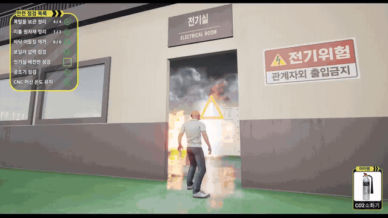

# SAFE OUT

첫 출근한 공장에서 일어나는 안전사고를 모두 막아야 퇴근할 수 있는 루프 기반 서바이벌 시뮬레이션입니다. 화재 종류에 맞는 소화기, 절연 장갑, 안전모처럼 실제 현장의 안전 수칙이 해결 방법입니다.

- 영상과 구현 설명: https://juni4268.github.io/safe-out/
- 플레이 빌드 (Windows): [Releases](https://github.com/juni4268/SAFE_OUT-Portfolio/releases/latest)

## 개요

| | |
|---|---|
| 엔진 | Unreal Engine 5.7 · C++ · 블루프린트 |
| 시점 | 3인칭 |
| 기간 | 2026년 4월~6월 (3개월) |
| 인원 | 4인 팀 'H2' |
| 담당 | 게임 프로그래밍 전체(C++ · 블루프린트), UI 구현 |

## 구현 내용

소개 페이지에서 영상과 함께 설명하는 부분입니다.

### 사고 이벤트의 공통 구조

사고 여덟 가지를 이벤트로 만들었습니다. 공통 기능을 부모 클래스 하나에 모으고, 각 이벤트는 조건과 결과만 다르게 구현했습니다. 이벤트는 대기, 발생, 조작 중, 해결, 실패 다섯 상태를 가집니다.

코드: [`CPREventBase.h`](Source/Project_CPR/CPREventBase.h), [`CPREventBase.cpp`](Source/Project_CPR/CPREventBase.cpp)

### 소화기와 화재

화재는 종류에 맞는 소화기로만 끌 수 있습니다. 소화기는 맞은 대상이 소화할 수 있는 대상인지만 확인하고, 불이 줄어드는 처리는 각 화재가 맡습니다.

코드: [`CPRExtinguishable.h`](Source/Project_CPR/CPRExtinguishable.h), [`CPRCharacter.cpp`](Source/Project_CPR/CPRCharacter.cpp), [`CPREvent_FireElec.cpp`](Source/Project_CPR/CPREvent_FireElec.cpp)

### 기계 과열

기계는 오일과 냉각수를 계속 소모합니다. 둘 중 하나가 바닥나면 온도가 오르고, 250°C에 닿으면 불이 납니다. 플레이어는 오일과 냉각수를 채워 온도를 내립니다.

코드: [`CPREvent_Overheat.cpp`](Source/Project_CPR/CPREvent_Overheat.cpp)

### 루프와 퇴근 조건

사고를 막지 못해 쓰러지면 같은 날 출근부터 다시 시작합니다. 안전 점검 목록의 항목을 모두 끝내야 퇴근할 수 있습니다.

코드: [`CPRClearTrigger.cpp`](Source/Project_CPR/CPRClearTrigger.cpp), [`CPRDieUI.cpp`](Source/Project_CPR/CPRDieUI.cpp)

## 조작

| 동작 | 키 |
|---|---|
| 이동 | W A S D |
| 시점 | 마우스 |
| 점프 | Space |
| 줍기 | E |
| 사용 | F |
| 버리기 | Q |
| 일시정지 | Tab / Esc |

## 그 외 코드

사고 이벤트 8종

| 사고 | 코드 |
|---|---|
| 오일 · 금속 파편 | [`CPREvent_Trap`](Source/Project_CPR/CPREvent_Trap.cpp) |
| 보일러 압력 상승 | [`CPREvent_Valve`](Source/Project_CPR/CPREvent_Valve.cpp) |
| 공조기 고장 | [`CPREvent_AirCon`](Source/Project_CPR/CPREvent_AirCon.cpp) |
| 낙하물 | [`CPREvent_HardHat`](Source/Project_CPR/CPREvent_HardHat.cpp) |
| 전기 화재 | [`CPREvent_FireElec`](Source/Project_CPR/CPREvent_FireElec.cpp) |
| 금속 화재 | [`CPREvent_FireLithium`](Source/Project_CPR/CPREvent_FireLithium.cpp) |
| 누전 차단기 | [`CPREvent_Generator`](Source/Project_CPR/CPREvent_Generator.cpp) |
| 기계 과열 | [`CPREvent_Overheat`](Source/Project_CPR/CPREvent_Overheat.cpp) |

플레이어, 아이템, 게임 흐름, UI

| 내용 | 위치 |
|---|---|
| 이벤트 배치 | [`CPREventSpawner.cpp`](Source/Project_CPR/CPREventSpawner.cpp) |
| 폭발물 보관 정리(안전 점검 항목) | [`CPREvent_ExplosivesZone.cpp`](Source/Project_CPR/CPREvent_ExplosivesZone.cpp) |
| 플레이어 입력: 이동, 줍기, 사용, 버리기 | [`CPRActionComponent.cpp`](Source/Project_CPR/CPRActionComponent.cpp) |
| 아이템과 아이템 데이터 | [`Item.cpp`](Source/Project_CPR/Item.cpp), [`ItemData.h`](Source/Project_CPR/ItemData.h) |
| 컷신 후 게임 시작 | [`CPRGameFlowManager.cpp`](Source/Project_CPR/CPRGameFlowManager.cpp) |
| 로딩 화면 | [`CPRGameInstance.cpp`](Source/Project_CPR/CPRGameInstance.cpp) |
| 안전 점검 목록 | [`CPRMissionWidget.cpp`](Source/Project_CPR/CPRMissionWidget.cpp), [`CPRTodoZoneTrigger.cpp`](Source/Project_CPR/CPRTodoZoneTrigger.cpp) |
| 기계 상태 화면 | [`CPROverheatWidget.cpp`](Source/Project_CPR/CPROverheatWidget.cpp) |
| 일시정지, 타이틀, 컷신 화면 | [`CPRPauseWidget.cpp`](Source/Project_CPR/CPRPauseWidget.cpp), [`CPRTitleUI.cpp`](Source/Project_CPR/CPRTitleUI.cpp), [`CPRCutsceneUI.cpp`](Source/Project_CPR/CPRCutsceneUI.cpp) |

## 팀

| 이름 | 역할 |
|---|---|
| 최준이 | 프로그래밍 |
| 박정환 | 팀장, 기획 |
| 이수림 | 레벨 디자인, 시네마틱 |
| 최지환 | 3D 모델링 |

## 이 저장소에 대해

포트폴리오용으로 **코드와 설정만** 공개합니다. 환경, 이펙트 등은 마켓플레이스(Fab) 에셋과 팀원들의 작업물이라 포함하지 않았고, 이 저장소만으로는 에디터에서 프로젝트를 열 수 없습니다.

- `Source/Project_CPR` — 게임 코드 (프로젝트의 코드 이름은 Project_CPR입니다)
- `Config` — 프로젝트 설정
- `Project_CPR.uproject` — 엔진 버전과 플러그인
